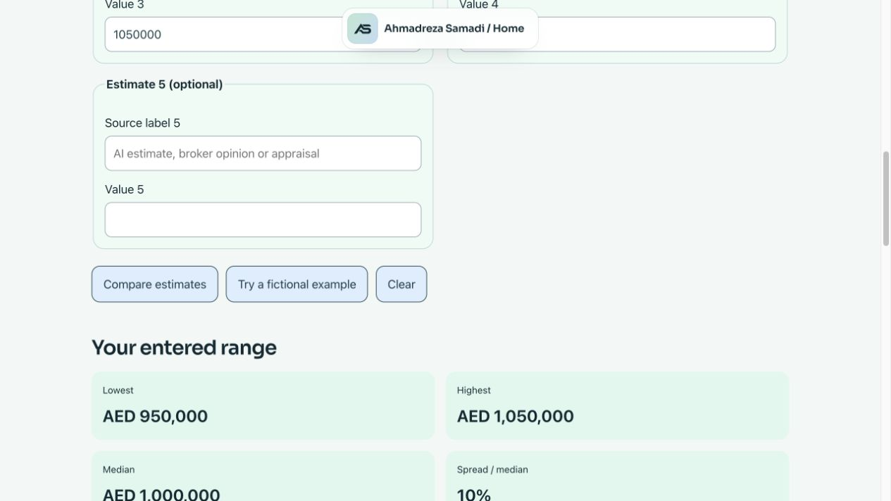

# Ahmadreza Samadi

Ahmadreza Samadi is a Dubai-based technology entrepreneur, Co-Founder & Technical Lead of Appraiva, which builds AI real estate intelligence, and Co-Founder & CEO of Royal Abraj Group.

I build AI that helps people make better property decisions, and I run a property business in Dubai, so I know where the AI must stop.

Also known as **Ahmad Samadi**. In Persian: **احمدرضا صمدی**; short name: **احمد صمدی**.

**Start with the decision.**

## Signature ideas

[Definitions, diagrams and practical checklists](https://a-samadi.com/ideas.html) for the three ideas below.

**Start with the Decision** is the series for these ideas and essays:

- **[Start with the decision.](https://a-samadi.com/writing/start-with-the-decision.html)** Name the decision, who makes it, the evidence needed and the next action before choosing a model or tool.
- **[Where the AI must stop.](https://a-samadi.com/writing/ai-human-review-real-estate.html)** AI prepares; a professional verifies and advises; the client decides.
- **[Cost per accepted result.](https://a-samadi.com/writing/ai-cost-per-verified-result.html)** Count retries, review and failures against results accepted under a defined rule. With no accepted results, unit cost is undefined.

## Current Focus

Co-Founder & Technical Lead, Appraiva. Appraiva is a US company in Cleveland, Ohio; I work remotely from Dubai. It builds AI tools that help real estate investors and developers find distressed and off-market properties through imagery analysis and enriched property data.

Co-Founder & CEO, Royal Abraj Group, Dubai. The group covers property brokerage and documents-clearing services; I lead its digital strategy and technology.

## Background

- Enterprise data engineering and machine learning.
- Azure data infrastructure for CRM migration and analytics at Oxfam Novib.
- Predictive customer segmentation at MCI.
- Education: Shahid Beheshti University.

## Selected work

- [My work at Appraiva: AI real estate intelligence](https://a-samadi.com/work/appraiva.html)
- [My work at Royal Abraj Group: digital strategy and technology](https://a-samadi.com/work/royal-abraj.html)
- [Oxfam Novib: a data foundation for CRM and analytics](https://a-samadi.com/work/oxfam-novib.html)

## Selected tools and writing

[**Property Decision Data**](https://a-samadi.com/studies/) brings together the studies and practical tools below. **Tech, explained** covers the plain-language technology explainers in [my writing](https://a-samadi.com/writing/).

[Start with the question — resource guide (English TXT)](docs/reading/start-with-the-question.txt). Choose among eight published resource groups by the question you need to answer, with a key limit for each.

[Selected public work — one-page PDF (English)](https://github.com/ahmadreza-smdi/ahmadreza-smdi/raw/refs/heads/main/docs/Ahmadreza-Samadi-Selected-Public-Work.pdf). Four selected resources with source links and method limits.

- [Rent and ownership scenarios](https://a-samadi.com/studies/rent-own-2026/): illustrative cash-budget scenarios across 393 metros, using ACS 2024 and HUD FY 2027 inputs. Renter and owner populations differ; these are not observed investment returns.
- [Metro rent burden: ACS 2024](https://a-samadi.com/studies/rent-burden/): reproducible point estimates for 386 US metropolitan areas, with raw Census data, CSV, chart and citation metadata. Not-computed units are excluded from the percentage denominator and reported separately; derived percentage margins of error are not calculated. [Reproducible source release](https://github.com/ahmadreza-smdi/metro-rent-burden/releases/tag/v1.1.1). [Excel companion](https://github.com/ahmadreza-smdi/metro-rent-burden/releases/download/v1.1.0/Metro-Rent-Burden-2024.xlsx) contains the same data in a filterable workbook.
- [Before You Build the AI](https://a-samadi.com/tools/before-you-build-ai.html): an interactive field guide for defining a useful decision, reviewing risks and planning a first test.
- [AI cost per accepted result](https://a-samadi.com/writing/ai-cost-per-verified-result.html): evaluating a workflow beyond its model-token price.
- [AI workflow cost ledger](https://github.com/ahmadreza-smdi/ai-workflow-cost): an offline Python tool that includes retries, failed attempts and review costs, with explicit acceptance criteria and unknown-cost checks. [Three fictional worked examples (ZIP)](https://github.com/ahmadreza-smdi/ai-workflow-cost/releases/download/v0.1.2/AI-Cost-Worked-Examples.zip) cover paid failures, no accepted results and explicitly known zero costs.
- [Jev: an AI decision model](https://a-samadi.com/writing/jev-ai-decision-model.html): what typed decisions offer and how I would test them.

- [Evidence Note](https://github.com/ahmadreza-smdi/evidence-note): an offline editor for recording a claim, its source and an unresolved decision. Export a note as HTML, Markdown or JSON, or restore a saved JSON note. Recording a source does not verify the claim. [Download v0.1.1 (ZIP)](https://github.com/ahmadreza-smdi/evidence-note/releases/download/v0.1.1/evidence-note-builder.zip).

Research in progress: [Price growth and rent benchmarks — working methods](https://github.com/ahmadreza-smdi/ahmadreza-smdi/blob/main/docs/research/price-and-rent-study-methods.md). The primary duration is five calendar years; exact dates, eligible metros and comparison results remain unresolved.

## Links

- Instagram: [@ahmadreza.samadi](https://www.instagram.com/ahmadreza.samadi/)
- Website: [a-samadi.com](https://a-samadi.com/)
- Newsletter: [Start with the Decision](https://www.linkedin.com/newsletters/7516204575893393408/)
- [Writing on AI products, data and PropTech](https://a-samadi.com/writing/)
- Biography: [English](https://a-samadi.com/about.html) · [فارسی](https://a-samadi.com/fa/about.html) · [العربية](https://a-samadi.com/ar/about.html)
- LinkedIn: [linkedin.com/in/ahmadreza-samadi](https://www.linkedin.com/in/ahmadreza-samadi/)
- Appraiva: [appraiva.com](https://appraiva.com/)
- Royal Abraj Group: [royalabrajgroup.com](https://royalabrajgroup.com/en)
- YouTube: [@ahmadreza-samadi](https://www.youtube.com/@ahmadreza-samadi)
- Crunchbase: [Ahmadreza Samadi](https://www.crunchbase.com/person/ahmadreza-samadi)

In Persian: [احمدرضا صمدی](https://a-samadi.com/fa/about.html).

## About this repository and citation

This profile is a reading guide for people evaluating Ahmadreza Samadi’s public work. By [Ahmadreza Samadi](https://a-samadi.com/about.html).

To cite this profile, use: Samadi, Ahmadreza. “Ahmadreza Samadi — public work and professional profile.” GitHub, `ahmadreza-smdi/ahmadreza-smdi`, accessed YYYY-MM-DD, with the exact commit permalink used. Cite individual studies and software using their own citation files and source-data references.

Original biography, selected portrait and AS mark are not assigned a blanket reuse licence; see [LICENSE](LICENSE). Existing research-code licences retain their stated scope.

The tool describes entered estimates; it does not verify a property value. [Open the valuation range checker](https://a-samadi.com/tools/valuation-range.html).
